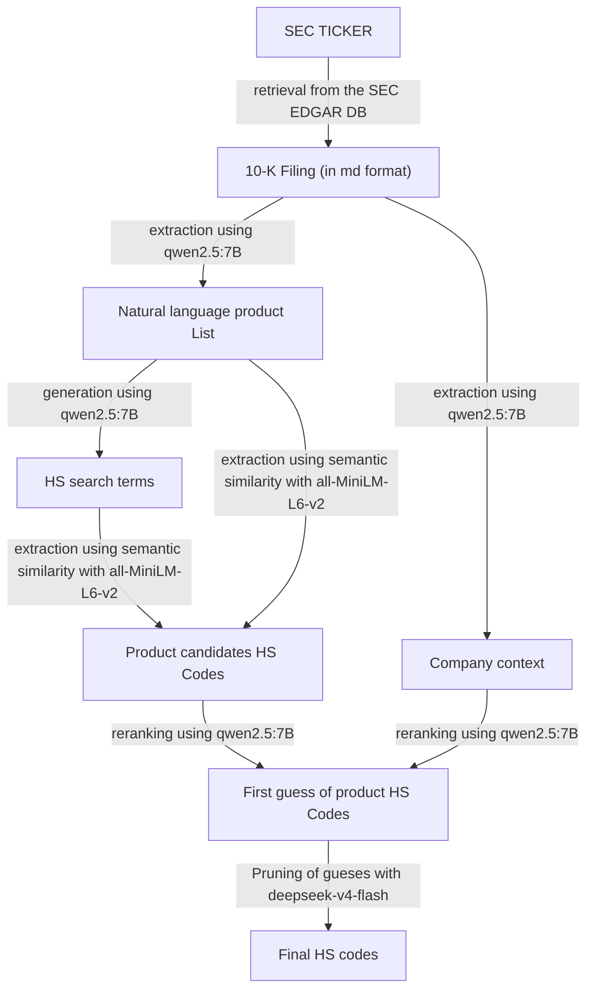

# Reproduction Repo - Product-to-Firm Mapping from SEC 10-K Filings

This repository holds the replication files that build a product-to-firm mapping from SEC 10-K filings. The pipeline reads a list of CIKs, downloads each firm's latest 10-K filing, extracts the physical product portfolio, and maps each product to 4-digit HS codes. The resulting mapping links HS codes to firms and can be used with Compustat or other firm-level panels.



## Repository layout

|File/root folder | Use |
|---|---|
|`scrap_sec_data.py` | Entry point. Runs the full pipeline. |
|`src/` | Python modules for SEC download, LLM calls, and semantic search. |
|`prompts/` | LLM prompt templates. |
|`data/` | Stores the CIK list, the HS code reference, and generated mappings. |

Use `example_config.py` as the template for your own local config file.

## Requirements

- Python 3.13 with the following packages: `edgar`, `openrouter`, `tiktoken`, `deepseek_tokenizer`, `sentence-transformers`, `pandas`, `numpy`, `tqdm`.
- An [OpenRouter](https://openrouter.ai/) API key.
- A valid SEC identity (name and email) for EDGAR downloads.

## Configuration

1. Copy `example_config.py` to `config.py` in the repository root.
2. Add your OpenRouter API key.
3. Add your SEC name and email.

Git ignores `config.py` because it holds secrets. Do not commit it.

## Reproduce the results

Run the full pipeline:

```bash
python scrap_sec_data.py
```

Default inputs and outputs:

| Flag | Default | Description |
|---|---|---|
| `-t` | `data/ciks.txt` | Comma-separated list of CIKs. |
| `-o` | `data/product_data/run.txt` | Output mapping file. |
| `-e` | `data/product_data/run_error_log.txt` | Error log file. |
| `-p` | `data/product_data/data_log.txt` | Pickle dump of the full pipeline object. |

Run with custom paths:

```bash
python scrap_sec_data.py -t data/ciks.txt -o data/product_data/run.txt -e data/product_data/run_error_log.txt -p data/product_data/data_log.txt
```

Run all commands from the root of the repository.

## Outputs

- `data/product_data/run.txt` — product-to-firm mapping.
- `data/product_data/run_error_log.txt` — errors per CIK.
- `data/product_data/data_log.txt` — full pipeline object as a pickle.

## Inputs

The following inputs are required. Set their paths in `config.py` or in the command-line arguments.

| Dataset | Where to get | Config key / location |
|---|---|---|
| CIK list | Included in repo | `data/ciks.txt` |
| HS code reference | Included in repo | `data/HSCodeandDescription.xlsx` |
| SEC 10-K filings | Downloaded at runtime from SEC EDGAR | SEC identity in `config.py` |
| LLM inference | [OpenRouter](https://openrouter.ai/) API | `API_KEY` in `config.py` |

## Notes

- The pipeline calls `qwen2.5:7b` through the OpenRouter API by default. `src/llm_utilities.py` supports local inference through Ollama, but it is not the default.
- Semantic search uses `sentence-transformers/all-MiniLM-L6-v2` on Apple Silicon (`mps`). If you use CPU or CUDA, change the device in `src/semantic_search.py`.
